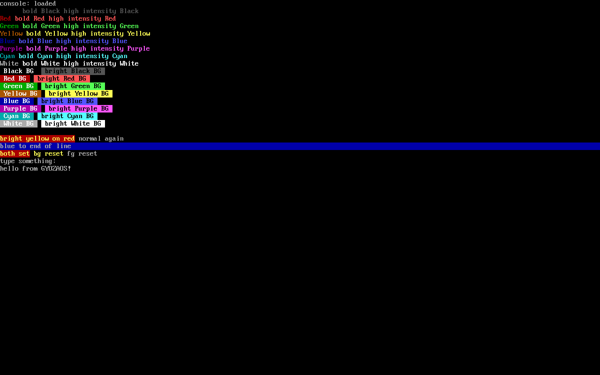

# GyozaOS

A hobby operating system written from scratch in C for x86-64, booted by
[Limine](https://github.com/limine-bootloader/limine).

The goal is a complete system — kernel, userland, and its own GUI — that can run
Linux applications. Software first runs by being compiled *for* GyozaOS; running unmodified Linux binaries is a later layer at
the system-call boundary, not a different kernel.

The display server will speak the **Wayland** protocol over its software
rendering path (`wl_shm`): clients draw into shared memory and hand the buffer
to the compositor, so no GPU driver is needed. A native toolkit will be built
alongside it, so the desktop is usable long before GTK or Qt can be ported.



## Status

| Milestone | State |
|---|---|
| 1 — Serial + framebuffer text | done |
| 2 — GDT and TSS | done |
| 3 — IDT and exceptions | done |
| 4 — Interrupt controller, timer, keyboard | done |
| 5–6 — Physical and virtual memory | next |
| 7 — Multitasking | |
| 8 — User mode and system calls | |
| 9 — Filesystem | |
| 10 — Userland: libc, init, shell | |
| 11 — GUI | |

What works today:

- **COM1 serial driver** — 16550 UART, polled, used as the primary debug output
- **`kprintf`** — freestanding formatter that fans output out to a list of sinks,
  so the same call reaches both the serial port and the screen
- **Framebuffer console** — 8x16 bitmap font, glyph blitting, cursor tracking,
  line wrapping, scrolling, tabs and destructive backspace
- **ANSI escape sequences** — SGR colours (16-colour palette, bold/bright),
  erase-in-line, erase-in-display, and cursor positioning
- **GDT and TSS** — kernel and user descriptors laid out for `syscall`/`sysret`,
  loaded with a far return, plus a 64-bit TSS
- **IDT and exception handling** — assembly entry stubs for all 32 CPU
  exceptions that normalise the stack (fake error code where the CPU pushes
  none), a shared save/restore path, and a C handler that prints a full
  register dump (plus CR2 on page faults) instead of triple-faulting;
  breakpoints (`int3`) resume execution
- **Hardware interrupts** — the legacy 8259 PIC remapped to vectors 32–47, with
  per-IRQ handler registration and end-of-interrupt handling
- **PIT timer** — programmable tick rate (100 Hz by default), a tick counter and
  a `hlt`-based millisecond sleep
- **PS/2 keyboard** — scancode set 1 translated to characters (US layout, Shift
  supported) and queued in a ring buffer between the IRQ handler and the kernel

## Building

Requires a C compiler, `make`, `git`, `xorriso`, `qemu-system-x86`, and `gdb`.
On an x86-64 Linux host the system `gcc` is sufficient — no cross-compiler needed.

```sh
# Arch
sudo pacman -S --needed base-devel git xorriso qemu-system-x86 qemu-ui-sdl gdb

# Debian / Ubuntu
sudo apt install -y build-essential git xorriso qemu-system-x86 qemu-system-gui gdb
```

```sh
make            # fetch dependencies, build the kernel, produce template.iso
make run        # boot it in QEMU
make debug      # boot halted, with a gdbstub on :1234
```

For source-level debugging:

```sh
make debug
# in another terminal
gdb kernel/bin/kernel
(gdb) target remote :1234
(gdb) break kmain
(gdb) continue
```

## Layout

```
kernel/src/
├── main.c              kernel entry point
├── arch/x86_64/        CPU-specific: GDT, IDT, ISR stubs, PIC, port I/O, control registers
├── drivers/            serial, framebuffer graphics, text console, font data, PIT timer, PS/2 keyboard
└── lib/                printf, string routines
tools/
└── psf2c.py            converts a PSF2 console font into a C header
```

`arch/` marks the boundary that would have to be rewritten for another
architecture. `lib/` holds code with no hardware knowledge.

## Credits

Built on the [Limine C template](https://github.com/limine-bootloader/limine-c-template-x86-64)
by Mintsuki and contributors (0BSD), and on the documentation at
[wiki.osdev.org](https://wiki.osdev.org).

The bundled `kernel/src/drivers/font.h` is generated by `tools/psf2c.py` from a
PSF2 console font; see the header of that file for its source.

## License

GyozaOS is licensed under the GNU General Public License v3.0 — see `LICENSE`.
